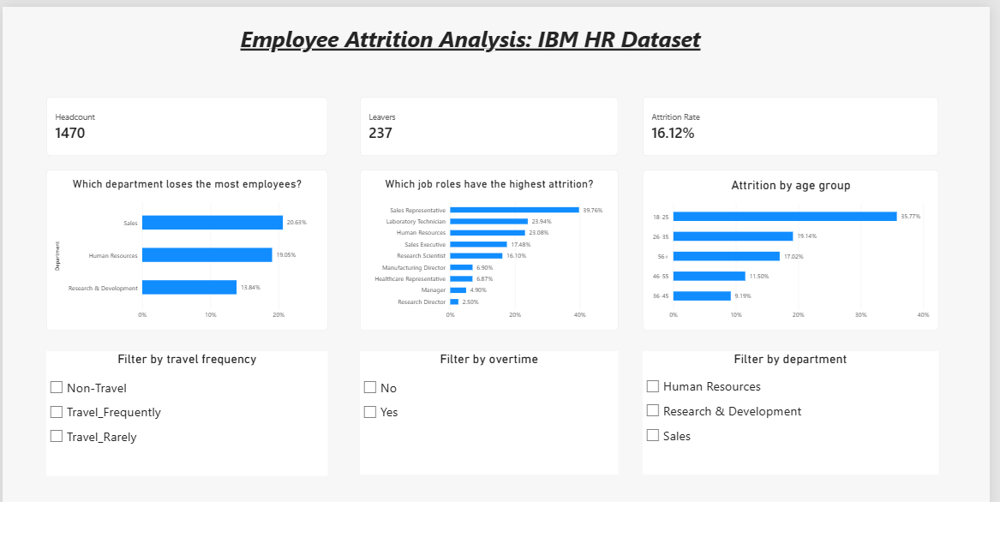
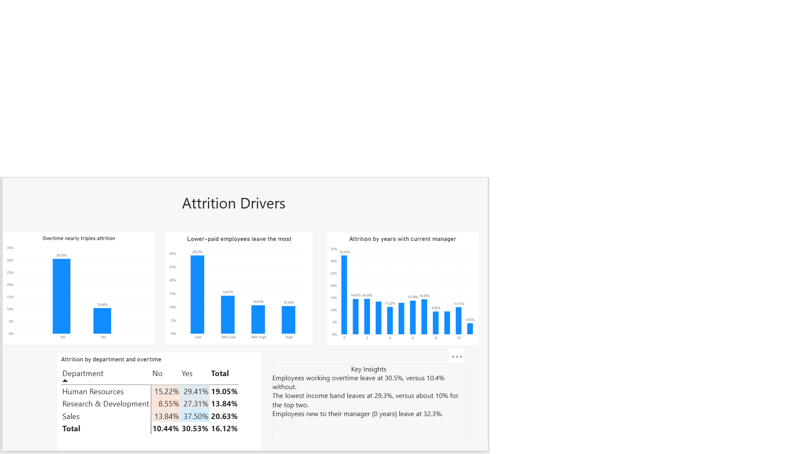

# IBM Employee Attrition Analysis

An end-to-end analysis of employee attrition using Python, SQL and Power BI.

## Objective
Find where and why employees leave, and suggest retention actions.

## Dataset
IBM HR Analytics Employee Attrition & Performance dataset (Kaggle): 1,470 employees, 35 attributes.

## Tools
Python (Pandas, Matplotlib), SQL (SQLite), Power BI, Google Colab

## Approach
1. Data checks: no missing values or duplicates; removed constant columns.
2. EDA in Pandas: attrition by department, role, age band, income band, travel, satisfaction and manager tenure.
3. SQL analysis: department and overtime breakdown, high-risk segment, role ranking.
4. Two-page Power BI dashboard (Overview and Drivers).

## Key findings
- Overall attrition rate is 16.1% (237 of 1,470 employees).
- Employees working overtime leave at 30.5%, versus 10.4% without overtime.
- Employees aged 18-25 leave at 35.8%, versus 9.2% for ages 36-45.
- Sales Representatives have the highest role attrition at 39.8%, with the lowest average income of any role.
- The lowest income band leaves at 29.3%, versus about 10% for the top two bands.
- Employees with 0 years under their current manager leave at 32.3%.
- A small segment of 28 employees (low income, overtime, frequent travel) has 71.4% attrition.

## Recommendations
- Review overtime and workload in Sales and Laboratory Technician roles.
- Run a pay review for the lowest income band, especially early-career staff.
- Strengthen onboarding and manager check-ins in the first year.
- Review the travel load for frequent travellers.

## Limitations
Findings show associations, not proven causes. Several factors (age, pay, role, overtime) overlap.

## Files
- `IBM_Employee_Attrition_Analysis.ipynb`: Python and SQL analysis (Google Colab notebook)
- `IBM_Attrition_Dashboard.pbix`: Power BI dashboard (open with Power BI Desktop)
- `WA_Fn-UseC_-HR-Employee-Attrition.csv`: source dataset

## Dashboard

